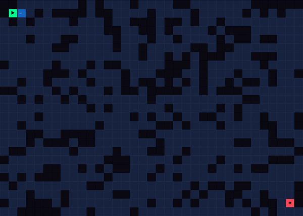
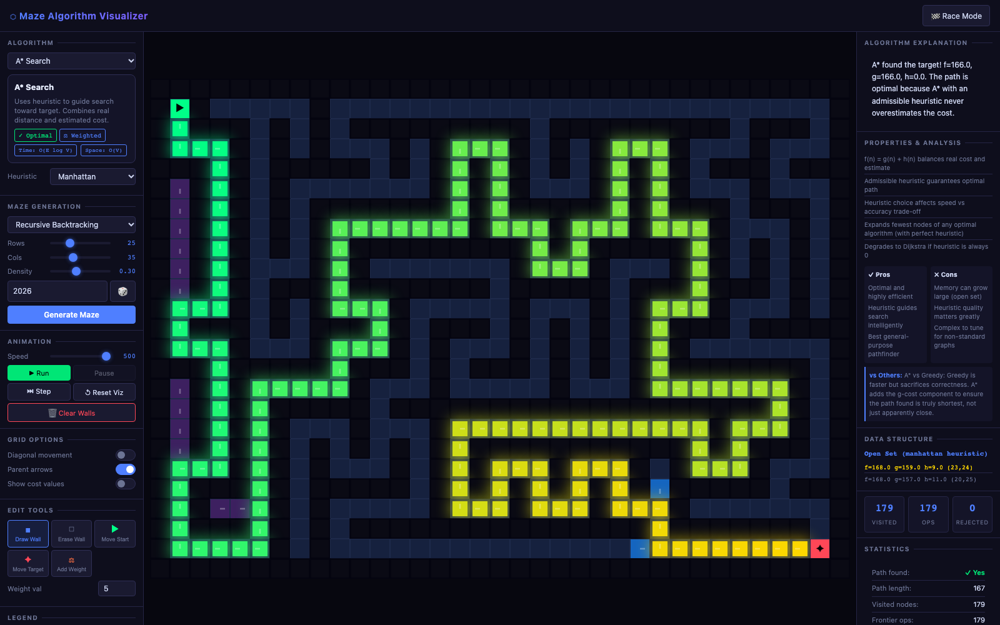
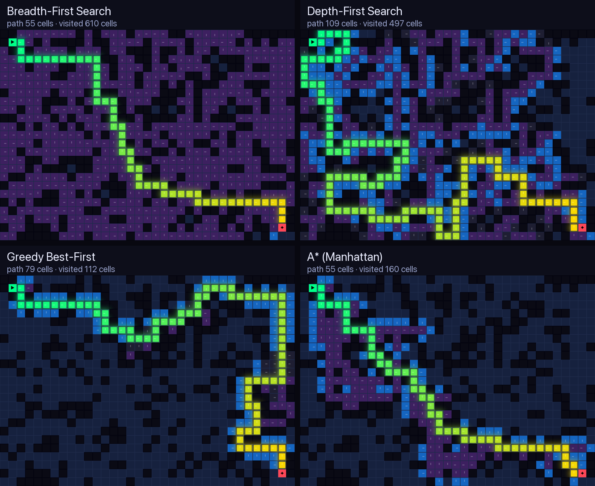
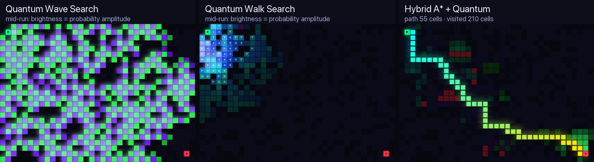
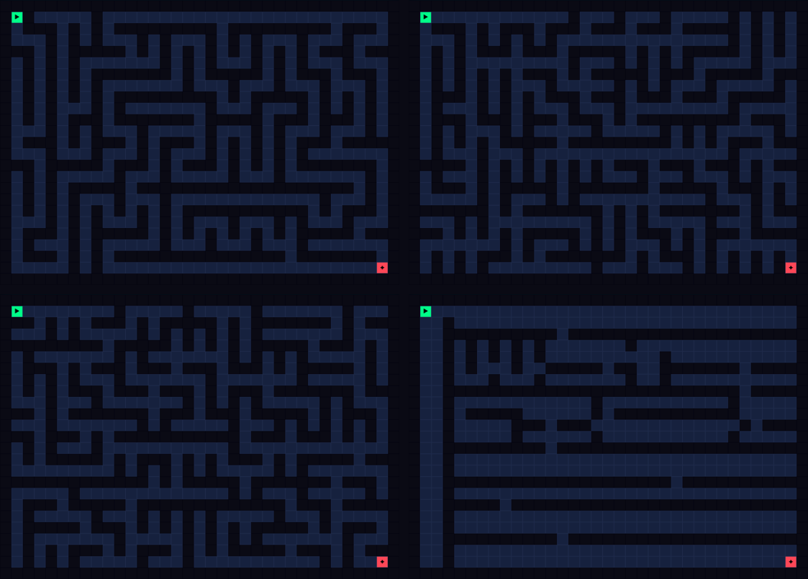
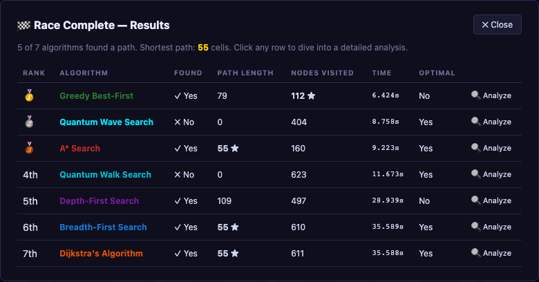

# Maze Algorithm Visualizer

**Watch pathfinding algorithms think, one step at a time.**

> [!NOTE]
> **The source code of this project is private.** This repository is its public showcase: the
> README, screenshots and every source file with its types and function signatures, but none of the
> code inside them. If you'd like a demo or to talk about the project, open an issue.

An interactive browser app that generates mazes and animates how search algorithms explore them. It covers six classical algorithms (BFS, DFS, Bidirectional BFS, Dijkstra, A* and Greedy Best-First) and three experimental quantum-inspired searches. While a search runs, a side panel explains each step and shows the live queue, stack or priority queue. A race mode runs the algorithms side by side on the same maze.

Plain JavaScript (ES modules) and HTML canvas. No framework, no build step, no dependencies.

<p align="center">
  
</p>



---

## Features

- **9 search algorithms**: 6 classical and 3 quantum-inspired. Every one runs step by step, so you can play, pause or advance a single step.
- **5 maze generators**: Recursive Backtracking, Prim's, Kruskal's, Recursive Division and Random Walls. Each takes a seed, so you can recreate the same maze.
- **Live explanation**: a running commentary on what the algorithm is doing, with its pros and cons and how it compares to the others.
- **Data structure view**: the current queue (BFS), stack (DFS), priority queue with `f = g + h` values (A*), or "superposition" (quantum modes).
- **Statistics and history**: path length, cells visited, frontier operations, rejected paths and runtime. Every run is added to a comparison table.
- **Editing tools**: draw or erase walls (right-click also erases), move the start and target, and paint weighted cells (cost 5 by default) to see how Dijkstra and A* route around expensive ground.
- **Grid options**: diagonal movement, parent arrows that show how each cell was reached, and cost values per cell.
- **Race mode**: BFS, DFS, Dijkstra, A*, Greedy, Quantum Wave and Quantum Walk run side by side on the same maze. A results table at the end lets you open a detailed analysis of any run.
- **Quantum settings**: six presets (Stable, Fast, Beautiful, Strong, Minimal, Huge) plus sliders for decay, diffusion, target bias and collapse threshold, and a debug panel.

## Algorithms

The numbers below come from one maze: Random Walls, seed `8`, density `0.28`, 25 × 35 cells.

| Algorithm | Optimal path | Weighted cells | Time | Path found | Cells visited |
|---|:---:|:---:|---|---|---|
| **Breadth-First Search** | ✅ | ❌ | O(V + E) | 55 | 610 |
| **Depth-First Search** | ❌ | ❌ | O(V + E) | 109 | 497 |
| **Bidirectional BFS** | ✅ | ❌ | O(b^(d/2)) | 55 | 434 |
| **Dijkstra** | ✅ | ✅ | O((V + E) log V) | 55 | 611 |
| **A\*** (Manhattan) | ✅ | ✅ | O(E log V) | 55 | **160** |
| **Greedy Best-First** | ❌ | ❌ | O(E log V) | 79 | 112 |
| **Hybrid A\* + Quantum** | ✅ | ✅ | O(E log V) | 55 | 210 |
| Quantum Wave Search | experimental | ❌ | n/a | not found | 557 |
| Quantum Walk Search | experimental | ❌ | n/a | not found | 623 |



**How to read the colours:** green → yellow is the final path, purple cells have been explored, blue cells are the frontier (queued but not explored yet), and dark cells are walls.

- **BFS** explores in rings around the start. It always finds the shortest path, but here it visits 610 of the open cells to do so.
- **DFS** dives down one corridor until it hits a dead end, then backtracks. It finds *a* path (109 cells), not the shortest one.
- **Greedy Best-First** always moves toward whichever cell looks closest to the target. It visits only 112 cells but takes a 79-cell route, because it never accounts for the distance already travelled.
- **A\*** ranks cells by `f = g + h`: the real cost so far plus a heuristic estimate of what's left. It finds the same 55-cell shortest path as BFS while visiting about a quarter as many cells.
- **Dijkstra** is BFS that understands cost. On weighted cells it finds the cheapest route rather than the one with the fewest steps.
- **Bidirectional BFS** searches from both ends and stops when the two searches meet.

**Heuristics** for A* and Greedy: Manhattan (best for 4-directional movement), Euclidean, and Chebyshev (for diagonal movement).

## Quantum-inspired modes



> ⚠ These modes are a **classical simulation of quantum-inspired ideas**, made to visualise concepts like amplitude, interference and measurement. They give no real quantum speed-up on a normal computer.

- **Quantum Wave Search** gives every cell a complex amplitude (a magnitude and a phase). Each step spreads amplitude to neighbouring cells and phase-flips the target (the "oracle"). It then applies a Grover-style diffusion and normalises. Where waves add up the cells glow bright, and where they cancel the cells dim. The search "collapses" once the probability at the target passes a threshold.
- **Quantum Walk Search** is a discrete-time quantum walk. Each cell holds four direction amplitudes (N/S/E/W) that are mixed by a Grover "coin" and then shifted, with walls reflecting them. A fading trail shows where the walk has been.
- **Hybrid A\* + Quantum** runs a real A* search for a reliable shortest path and overlays an amplitude field around its frontier. Routes that A* abandons fade out in red.

Wave and Walk are exploratory. On the maze above, both hit their 220-step limit before the target probability reached the collapse threshold, so they found no path. The Hybrid mode always finds the optimal path because A* does the actual routing.

## Maze generators



| Generator | Character |
|---|---|
| **Recursive Backtracking** (top left) | Long, winding corridors with few branches; a "perfect" maze with exactly one route between any two cells |
| **Prim's** (top right) | Many short dead ends that branch out from a growing tree |
| **Kruskal's** (bottom left) | Evenly spread, uniformly random structure |
| **Recursive Division** (bottom right) | Long straight walls with single gaps, so it feels like rooms and hallways |
| **Random Walls** | Open grid with scattered obstacles (set by *Density*), where many routes exist; the best maze for comparing algorithms |

Grid size goes from 10 to 60 rows and 10 to 80 columns. Speed goes from 1 to 500 steps per second.

## Race mode



Race mode gives each algorithm its own canvas and runs them all at once on the same maze. At the end it shows how many found a path, the shortest path length (★ marks the best values), cells visited and time. Click any row to open a detailed analysis.

## How it works

Each search algorithm is a JavaScript **generator function**. Every `yield` hands back a snapshot of the search: the current cell, the visited set, the frontier, parent pointers, rejected cells, an explanation and stats. The animation loop pulls one step at a time at the chosen speed and passes it to the renderer. That's why pause and single-step work for every algorithm without extra code.

The classical algorithms share a small set of helpers: a binary min-heap for Dijkstra and A*, path reconstruction from parent pointers, and the heuristics. The quantum modes keep their state in `Float32Array`s and have their own heatmap renderer. All maze generators use a seeded random number generator, so a seed always gives the same maze.

## Project structure

```
index.html                  Layout: controls | maze canvas | explanation and stats
css/style.css               Dark theme and all components
js/
├── app.js                  State, animation loop, UI bindings, race mode
├── constants.js            Cell states, colours, algorithm descriptions
├── grid.js                 Grid of cells, walls and weights
├── renderer.js             Canvas drawing for the classical algorithms
├── heuristics.js           Manhattan, Euclidean, Chebyshev
├── mazeGenerators.js       The 5 seeded maze generators
├── algorithms/
│   ├── bfs.js  dfs.js  bidirectional.js
│   ├── dijkstra.js  astar.js  greedy.js
│   ├── quantumWave.js      Amplitude, interference, oracle, diffusion
│   ├── quantumWalk.js      4-direction amplitudes with a Grover coin
│   ├── hybridQuantumAstar.js
│   └── quantum.js          Earlier quantum version (still wired up, not in the menu)
└── quantum/
    ├── quantumMath.js      Complex numbers, Grover coin and diffusion
    ├── quantumSettings.js  Defaults and the 6 presets
    ├── quantumExplain.js   Live explanation text for the quantum modes
    └── quantumRenderer.js  Heatmap, trails and direction arrows
docs/images/                Screenshots used in this README
```

## License

© 2026 Christo Dontchev. All rights reserved. The source code is private and is not licensed for
use, copying or distribution; see [LICENSE](LICENSE).
